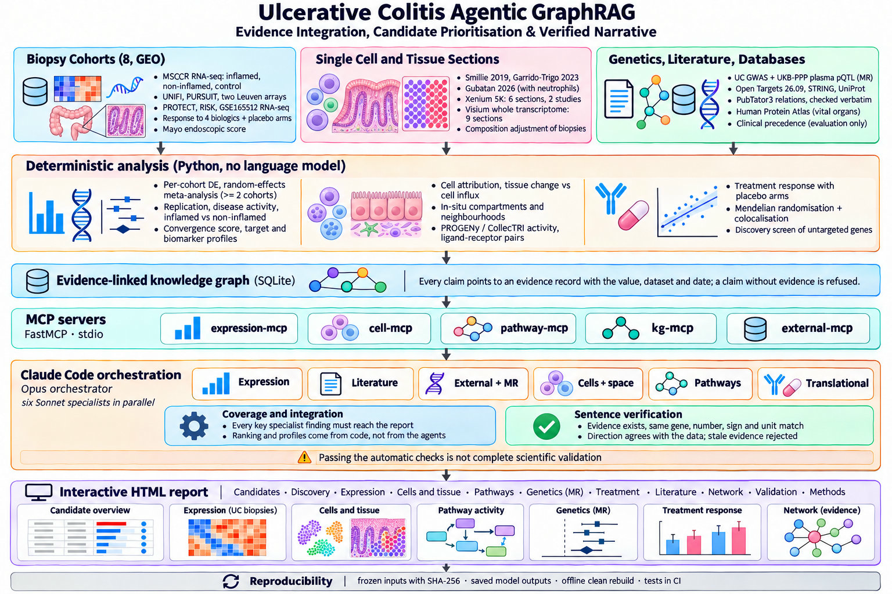

# Agentic Multi-omics Target Atlas for Ulcerative Colitis

**A reproducible, evidence-based screen for drug targets, immune pathways and biomarkers in ulcerative colitis (UC).**

## Explore the interactive atlas

### [Open the live report →](https://rsolerortuno.github.io/agentic-colitis-atlas/)

**Browse the candidate targets, inspect the evidence behind every sentence, and explore cells, real tissue sections
with their H&E picture, 3D protein structures, immune pathways, human genetics in blood and gut, and treatment
response.** The report opens directly in your browser; no installation is needed. Use the Sections menu, the "?"
buttons next to every chart and the "How to read this chart" boxes to explore each analysis.

[](https://rsolerortuno.github.io/agentic-colitis-atlas/)

---

This is the same system as the [kidney cancer atlas](https://github.com/rsolerortuno/agentic-kidney-atlas)
([live report](https://rsolerortuno.github.io/agentic-kidney-atlas/)), applied to an immune-mediated disease.

[Reproduction guide](docs/reproduction.md) ·
[Limits of the automatic checks](docs/numeric-claims.md) ·
[Evaluation results](evals/results.md) ·
[Change history](evals/history.md) ·
[Milestones and their checks](PROGRESS.md)

## Summary

Ulcerative colitis is a chronic inflammation of the lining of the colon. Biologic drugs (anti-TNF, anti-integrin,
anti-IL-23) and small molecules (JAK and S1P inhibitors) help many patients, but about half do not reach remission,
so researchers look for new targets and for markers that tell patients apart.

This project screens about 26,500 human genes against that question. For each gene it combines independent kinds of
public evidence: how the gene changes in inflamed colon compared with healthy colon in eight patient cohorts, whether
the change is a change of the tissue or the arrival of immune cells, which cell makes it and where it sits in tissue
sections, which immune pathways and cell-to-cell signals it belongs to, whether people who carry genetic variants that
raise its level in blood or in the colon wall get the disease more often, whether its protein has a pocket a small
molecule could use, how it relates to response to four biologics, and what the literature and drug databases already
say. A gene is a good candidate when several unrelated lines of evidence agree.

The ranking is then checked against evidence it never used: protein measured in other patients' mucosa, two more
GWAS, mouse knockouts, a second single-cell imaging platform, an anti-TNF single-cell atlas, more treatment trials,
target safety, a covariate-adjusted model and a negative control.

All statistics are computed by code. AI agents (Claude) only choose what to look at and write short explanations, and a
separate checker verifies every sentence against the stored evidence. The output is a ranked list and a self-contained
interactive report.

**Status.** This is a research prototype built on public data. It generates hypotheses. It has not been tested in the
laboratory or in patients, and it is not medical advice. The limits are listed in [section 8](#8-limits-and-open-issues).

## Contents

1. [Scientific background](#1-scientific-background)
2. [How the method works](#2-how-the-method-works)
3. [Data sources](#3-data-sources)
4. [Methods in brief](#4-methods-in-brief)
5. [Main results](#5-main-results)
6. [How the results were checked](#6-how-the-results-were-checked)
7. [Reproducing the analysis](#7-reproducing-the-analysis)
8. [Limits and open issues](#8-limits-and-open-issues)
9. [Repository map](#9-repository-map)
10. [Glossary](#10-glossary)

## 1. Scientific background

In ulcerative colitis the immune system attacks the inner lining of the colon, starting at the rectum. Inflamed
mucosa fills with immune cells from the blood, above all neutrophils; the epithelium loses its normal metabolism and
barrier; fibroblasts become inflammatory. Approved drugs block TNF (infliximab, golimumab), the gut-homing integrin
α4β7 (vedolizumab), IL-12/IL-23 (ustekinumab) or JAK and S1P signalling.

Two kinds of discovery matter here:

- A **target** is something a drug can act on. A good target changes in the diseased tissue itself (not only because
  other cells arrived), is made by the cells you want to reach, is reachable by a drug and, ideally, has human genetic
  support for a causal role.
- A **biomarker** is something you can measure to tell patients apart, for example to grade inflammation or predict
  who will respond.

A target and a biomarker need different evidence, so the project scores them separately. One trap is specific to
inflamed tissue: a gene that looks higher in a biopsy may simply belong to the neutrophils that came in. The project
tests that explicitly.

## 2. How the method works



The idea is **convergence**. Any single test can mislead, so a gene is ranked highly only when independent kinds of
evidence point to it. There are four stages.

1. **Measure (code only).** Python scripts run the statistics: inflamed against healthy colon in eight cohorts with a
   meta-analysis, inflamed against non-inflamed mucosa of the same patient, single cells, a cell-composition
   adjustment, tissue sections, pathway activity, ligand-receptor signals, disease activity, treatment response,
   Mendelian randomisation and drug databases. No language model sees raw data or computes a number.
2. **Store with receipts.** Every result is saved in a knowledge graph as a *claim* attached to an *evidence record*
   that holds the value, the dataset and the date. The database refuses a claim without an evidence record.
3. **Interpret (AI agents).** Six agents with limited tools read the graph through five MCP servers and write short
   findings: expression, literature, external databases and genetics, cell context, immune pathways and translational
   questions (treatment response, new candidates). An orchestrator writes the summary and checks that every key
   finding of the specialists reaches it.
4. **Verify.** A checker tests each sentence: the cited record must exist and belong to the same gene, each number must
   match one specific field of that record with its sign and unit, the up or down wording must agree with the data,
   and the record must not have changed since the agent read it. Sentences that fail are removed.

The checker reports "no failures detected by the automatic checks". That is not proof that every interpretation is
correct; see [docs/numeric-claims.md](docs/numeric-claims.md).

## 3. Data sources

All data are public. Files are listed with checksums in [reproducibility/inputs.json](reproducibility/inputs.json)
and described in [data/README.md](data/README.md).

| Evidence | Source | Size or scope |
|---|---|---|
| Inflamed vs non-inflamed vs healthy colon | Mount Sinai MSCCR registry, RNA-seq (GEO GSE193677) | 293 inflamed, 391 non-inflamed UC and 340 control biopsies; 135 patients with both inflamed and non-inflamed biopsies |
| UC vs healthy colon, replication | UNIFI (GSE206285), PURSUIT (GSE92415), two Leuven cohorts (GSE16879, GSE73661): microarrays; PROTECT (GSE109142), RISK (GSE117993), GSE165512: RNA-seq | 1,017 UC and 169 control biopsies analysed |
| Treatment response | UNIFI ustekinumab and placebo, PURSUIT golimumab and placebo, ACT1 infliximab and placebo (GSE23597), EUCALYPTUS etrolizumab (GSE72819, RNA-seq), infliximab (GSE16879), vedolizumab (GSE73661) | Biopsies taken before treatment |
| Protein in mucosa | Schniers et al. 2019 (Clin Proteomics), label-free proteomics of untreated UC vs healthy colon | 7,416 proteins mapped to genes |
| Mouse models | MGI genotype-phenotype calls (colitis terms), single-gene models including conditional knockouts | 236 genes with a colitis phenotype |
| Disease activity | Mayo endoscopic score (MSCCR, GSE73661) | One value per patient |
| Single cells | Smillie et al. 2019 (Broad SCP259); Garrido-Trigo et al. 2023 (CZ CELLxGENE); Gubatan et al. 2026, with neutrophils (Broad SCP3755); anti-TNF atlas of Thomas et al. 2024, full count matrices (GEO GSE282122, typed here into lineages) | 365,492, 46,700, 408,930 and 694,801 cells (GSE282122: 103 UC biopsies before and after adalimumab, 9 healthy) |
| Tissue sections | Xenium 5K (GSE312420, GSE339323); CosMx 6K and 1K (GSE312415); Visium whole transcriptome with H&E images (GSE189184) | 6 Xenium sections (619,017 cells); 2 CosMx slides of inflamed UC (88,409 cells); 9 Visium sections (16,699 spots, deconvolved into 12 cell groups) |
| Human genetics | UC GWAS (de Lange et al. 2017, GWAS Catalog GCST004133); fine-mapped QTL from Open Targets 26.09: plasma pQTL (UKB-PPP), colon eQTL (GTEx v10 transverse and sigmoid colon, CEDAR colon and rectum), gut cell-type eQTL (IBDverse single cell) | 1,693 proteins; 5,852 genes in colon tissue; 6,895 genes in about 60 gut cell types |
| Variant effects | AlphaGenome Atlas (pre-computed RNA-seq effects, colon tissue and blood immune cells) and AlphaGenome 2 (live predictions in 12 colon cell types), Google DeepMind; UC GWAS of Liu et al. 2023 (GCST90446794). Outputs for non-commercial research only | 142 UC loci outside the MHC, 2,381 credible-set variants; 1,644 cell-type predictions |
| Protein structure | AlphaFold DB models; PDBe-KB ligand sites | 46 proteins (candidates and 10 UC small-molecule targets as controls) |
| Pathways and signals | PROGENy, CollecTRI (decoupler), OmniPath ligand-receptor pairs | 14 pathways, transcription factors, cell-to-cell pairs |
| Literature | PubTator3 | 299 publications; 203 relations checked word for word |
| Drugs and druggability | Open Targets 26.09, STRING, UniProt, Reactome, Human Protein Atlas | Clinical stage, tractability for every gene, vital-organ expression |

## 4. Methods in brief

- **Inflamed vs healthy.** Per cohort, Welch t-test on patient-level values (biopsies of one patient averaged), with
  Benjamini-Hochberg correction; inflamed vs non-inflamed mucosa of the same patient by paired test.
- **Meta-analysis.** DerSimonian-Laird random effects over the eight cohorts. A pooled call needs at least two cohorts.
- **Convergence score.** Six evidence streams (expression, replication, inflamed vs non-inflamed, genetics,
  literature, tractability), each scaled from 0 to 1 and weighted as set in [config.yaml](config.yaml) before the
  results were examined.
- **Two profiles.** A *target* profile (rise in UC, tissue change after composition adjustment, genetics, predicted
  tractability) and a *biomarker* profile (any change, replication, disease activity, inflamed vs non-inflamed) use
  measurements only, without literature or drug history, so they can be tested against clinical targets without
  circularity. Each rank comes with an interval from 1,000 random re-weightings.
- **Tissue change or cell influx.** Per gene, the inflamed effect is re-estimated after adjusting for the abundance of
  neutrophils, myeloid cells, lymphocytes, plasma cells, epithelium and stroma in each biopsy; the share of the change
  that survives decides whether it is a tissue change.
- **Cells and tissue.** Pseudobulk cell-type attribution in four single-cell atlases (GSE282122 typed here into
  lineages from canonical markers); a lineage replicates when two of the three other atlases agree; in Xenium sections, the
  share of a gene's transcripts in each cell lineage and the lineages enriched around expressing cells (permutation
  test). Visium spots hold several cells, so each spot is deconvolved into 12 cell groups with the single-cell
  profiles (non-negative least squares on marker genes; candidate genes are never markers). A gene's spot expression
  is then regressed on the spot shares to name the cell group that explains it in the tissue, and the cell groups
  around its top-decile spots are tested against random spots (permutation test), as in the kidney atlas.
- **Mendelian randomisation.** Fine-mapped cis instruments on the UC GWAS, in three layers: plasma protein (UKB-PPP),
  gene expression in colon tissue (GTEx v10, CEDAR) and in single gut cell types (IBDverse). Wald ratio or
  inverse-variance weighted estimate, Benjamini-Hochberg over genes, and a colocalisation check with IBD GWAS signals
  for the significant ones. Every estimate is repeated with FinnGen R12 as an independent outcome and combined.
- **Independent checks.** Protein-level replication in a separate proteomics study; mouse knockouts with colitis
  phenotypes (MGI); CosMx single-cell sections; machine-extracted PubTator3 relations next to the checked ones.
- **Protein structure.** AlphaFold models trimmed below pLDDT 50, cavities detected with pyKVFinder and ordered by a
  pocket score (model confidence, geometry, hydrophobicity); cavity detection checked against ligand-binding residues of
  experimental structures (PDBe-KB).
- **Patients and drug types.** Paediatric against adult cohorts, rectum against proximal colon, and a neutrophil
  activity axis by Mayo grade; a suitability score for antibodies and other biologics (surface or secreted, increase,
  vital-organ expression, share of patients); an immune-target score (immune share, coupling with infiltration,
  increase, tractability, response).
- **Treatment response.** Responders against non-responders per arm, placebo arms included, and a drug × arm
  interaction, with the published infliximab non-response genes (Arijs 2009) as a positive control.
- **Discovery screen.** Genes that rise in UC as a tissue change, are tractable, have no clinical drug, few UC papers
  and low expression in vital organs.
- **Validation shortlist.** Each first-in-class gene checked against eight questions a laboratory would ask
  (reproducible, protein, tissue change, cell source, causal genetics, druggable, safety, UC literature, mouse), one traffic light
  per question with fixed thresholds checked on markers and on the UC clinical targets. Genes are reported in
  groups, not positions: A, B or C by how many of six ways of scoring keep them in the top ten. A green cell-source
  light needs the lineage to be dominant in at least two of the three other single-cell atlases; genes made mainly by
  neutrophils are reported as neutrophil-directed and their per-cell change is measured inside neutrophils. Two repair flags
  cap that light: crypt-zone epithelial genes and crypt-niche fibroblast genes (WNT2B+, RSPO3+) that rise per cell
  there. The proposed first experiment follows the concrete cell clusters that hold the gene's RNA and the drug
  route. Three lists under Findings → New targets, all with the same lights: "Well known in UC, no drug yet" (37
  genes of the Candidates top 100 with established UC biology and no drug), the first-in-class shortlist (46 genes,
  few papers, no drug) and Repurposing (42 genes with an inhibitor for another disease, never tried in UC).
  Neutrophil-made genes pass the discovery screen as neutrophil-directed candidates.

## 5. Main results

Numbers come from the saved, reviewed analysis (`runs/2026-11-11`, the agent run redone with four single-cell atlases). The report gives the detail and the caveats.

**Known biology is recovered.**
Inflamed mucosa gains antimicrobial, neutrophil and tissue-remodelling genes (S100A8, LCN2, DUOX2, CXCL8, MMP3) and
loses the metabolism and transport genes of the colon lining (AQP8, SLC26A2, HMGCS2). 1,625 genes change at least
two-fold in the meta-analysis of eight cohorts. TNF, NF-κB and JAK-STAT pathway activity is higher in UC in all eight
cohorts, matching the approved drug classes.

**The strongest convergent signal is mostly cells arriving.**
The neutrophil chemokine axis (CXCR2, CXCR1, CXCL8) leads the convergence ranking. Single-cell data with neutrophils
put almost all CXCR2 and CXCR1 transcripts in neutrophils, and after adjusting the biopsies for their cell mix CXCR2
keeps 17 % of its change and CXCL8 14 %. These genes are markers of neutrophil influx, and targets only on the
recruited cells.

**Changes of the tissue itself.**
MMP1 and CHI3L1 in inflammatory fibroblasts, DUOX2 in the epithelium and IDO1 keep a significant change after the
adjustment, 36–44 % of it (more than twice the neutrophil genes, though below the 50 % that counts as a pure tissue
change), and the Visium sections place them in the same compartments. None has human genetic support. The loss of
epithelial metabolism genes (AQP8 keeps 59 %, a tissue change) is the cleanest biomarker of inflamed mucosa.

**Human genetics.**
Mendelian randomisation with plasma proteins recovers the ustekinumab target: genetically higher IL12B raises UC risk
(odds ratio 1.54 per SD, colocalised with the UC GWAS signal), although IL12B barely changes in biopsies. IL10 and
PD-L1 (CD274) are strongly protective, consistent with IL-10-deficiency colitis and checkpoint-inhibitor colitis.
TNFRSF6B and CD274, both in the target profile's top ten, are protective, so genetics supports activating rather than
blocking them. The leading expression candidates (CXCL8, IDO1, MMP1, CHI3L1) are null where they can be tested, and
CXCR2, OSM, DUOX2, JAK2 and TNF have no plasma instrument.
Repeating the test with expression measured in the colon wall finds 135 genes with a causal estimate, 38 of them
sharing the UC or IBD GWAS signal: established IBD risk genes such as IRF5, GSDMB, RGS14, NXPE1, IRF8 and GNA12, and
the TNFRSF6B locus again. IDO1, MMP1 and CHI3L1 are null in the colon too. Where a gene has instruments in both blood
and colon (509 genes), the two estimates point the same way in 61 %. In FinnGen, an independent Finnish GWAS, 34 of
the 64 significant plasma proteins and 168 of 296 significant gut estimates replicate (same sign, p < 0.05), including
IL12B, IL10, CD274, TNFRSF6B, IRF5, GSDMB and NXPE1.
AlphaGenome predicts, from DNA sequence, how the UC risk alleles of 142 GWAS loci change expression. Checked against
measured, fine-mapped eQTL, its strongest quarter of predictions has the right direction in 94 % (colon tissue) and
100 % (matching colon cell type, against 75 % in a wrong cell type). Above that threshold, 7 loci act on 17 genes;
among this atlas's candidates and clinical targets only CCL20 (risk allele raises it in blood T cells and monocytes)
and IL10 (risk allele lowers it in T cells, as the protective MR estimate expects). The candidate genes were picked
for their change in inflamed biopsies and almost none sits at a UC risk locus, so AlphaGenome cannot fill their
genetics.

**Unexplored candidates.**
A separate screen looks for genes that rise in UC as a tissue change, are reachable by a drug, have no clinical drug,
few UC papers and low expression in vital organs. 36 pass, for example CHRDL2, CPXM1 and FIBIN in stroma, XKR9 and
LYPD5 in the epithelium, LAX1 in T cells. They are hypotheses for experimental validation, not discoveries.

**Where the candidates sit in the tissue.**
Deconvolving the Visium spots puts S100A8, CXCL8, AQP9 and IL1B in neutrophils, MMP1, MMP3 and MMP10 in inflammatory
fibroblasts, and LCN2, DUOX2 and REG1A in the epithelium, matching the single-cell attribution. Neutrophil-gene hot
spots are surrounded by neutrophils and inflammatory fibroblasts, the ulcer-bed niche. Neutrophils make up 1.7 % of the
estimated transcripts in UC spots against 0.9 % in healthy colon.

**Protein and mouse models.**
In an independent proteomics study, 75 % of the clear RNA changes (281 of 373 tested) change again as protein in the
same direction, among them DUOX2, CHI3L1, IDO1, LCN2, S100A8 and the lost AQP8, HMGCS2 and SLC26A2. In mice, 24 % of
UC clinical targets have a colitis phenotype against 1.2 % of all genes, and 15 % of the convergence top 100: the
ranking is enriched about tenfold without using mouse data. In the literature, every leading candidate has been
perturbed in mouse colitis (for example CXCR2, IDO1, DUOX2, CHI3L1), but none of the 36 first-in-class genes has.

**Cell-to-cell circuits.**
Neutrophils send OSM to OSMR on inflammatory fibroblasts, the neutrophil-stromal circuit described by Gubatan et al.
2026; OSMR is one of the targets that entered UC trials recently.

**Treatment response.**
In UNIFI, about 3,500 genes separate ustekinumab non-healers from healers before treatment, but about 2,800 also
separate placebo non-healers: the signal is mostly disease severity. TNF and NF-κB activity is higher before
treatment in non-responders to infliximab, ustekinumab and vedolizumab and also in placebo non-responders. No gene
separates a drug from placebo after correction. The published infliximab non-response genes (IL11, IL13RA2, PTGS2,
STC1, TNFRSF11B) are all higher in non-responders, as reported; in ACT1 they are higher in infliximab non-responders
and not in the 13 placebo patients, a lead for a drug-specific signal that the interaction test cannot confirm.
Etrolizumab remission (EUCALYPTUS, 12 of 70) is not predicted by any single gene. In the anti-TNF single-cell atlas
(6 remitters, 14 non-remitters on adalimumab), DUOX2 and LCN2 are lower in the colonocytes of non-remitters before
treatment: the response signal sits in the epithelium. In children starting corticosteroids (PROTECT), 1,263 genes
differ by week-4 remission, again mostly severity; faecal calprotectin follows the biopsy only weakly.

## 6. How the results were checked

| Check | Result |
|---|---|
| Agent text against its evidence | 116 statements checked, no failures detected by the automatic checks; 28 of 28 key findings of the specialists reach the report |
| Deliberately corrupted copies of those statements | Caught: 100 % of changed numbers (76/76), other-gene attributions (81/81) and swapped evidence (81/81); 72 % of flipped directions where the sentence cites expression evidence (23/32), 32 % of all flipped directions (literature, cell and treatment sentences are not direction-checked) |
| Target profile against 59 UC clinical targets | AUROC 0.85; predicted tractability alone gives 0.83, so the gain is in early enrichment: 12 % of the clinical targets in the profile's top 100 against 2 %. Without the "high-quality ligand" bucket (medicinal-chemistry history) 0.83 |
| Targets first tried in UC from 2016 on (20 genes) | Target profile AUROC 0.81; 3 of the 20 (MAP3K8, OSMR, IL1B) in its top 100, none for predicted tractability alone. Retrospective: the data are not frozen at 2016 |
| Convergence score (includes literature and drug history) | AUROC 0.88, partly circular; data-only version 0.78 |
| Mendelian randomisation positive controls | IL12B (ustekinumab target) is the strongest of 1,693 proteins; IL10 and CD274 protective. Only 15 of the 59 clinical targets have a plasma instrument |
| Visium compartments against single-cell attribution | Neutrophil, epithelial and fibroblast genes land in the expected compartment (automated test) |
| Visium deconvolution, held-out genes (never markers) | S100A8, LCN2, DUOX2, MMP3 and CHI3L1 follow the share of their single-cell cell group (Spearman 0.18–0.61); low-count genes such as CXCR2 follow weakly (0.07) |
| Gut eQTL Mendelian randomisation | Known IBD risk genes (IRF5, GSDMB, RGS14, NXPE1) come out significant and colocalise (automated test for IRF5) |
| MR replication in FinnGen R12 | 34 of 64 significant plasma proteins and 168 of 296 significant gut estimates replicate (same sign, p < 0.05) |
| MR replication in Liu 2023 (largest UC GWAS, overlapping samples) | 58 of 64 plasma proteins and 276 of 296 gut estimates replicate |
| MR sensitivity | Plasma, 48 proteins with >= 3 instruments: no directional pleiotropy in 43 (MR-Egger), weighted median agrees in 45; Steiger direction correct for every significant estimate in all layers |
| Covariate adjustment (MSCCR: colon segment, age, sex) | Adjusted and unadjusted changes correlate at rho 0.99; all 1,086 clear changes hold |
| Negative control | Clinical targets compared only with genes of similar expression: convergence AUROC 0.86, target profile 0.82, random sets <= 0.57; matched on literature 0.73 and 0.70 |
| Target safety | 2 candidates strongly constrained (INHBA, GJC1; 5 of 59 clinical targets); PheWAS recovers psoriasis for IL12B and blood counts for ITGA4; a Mendelian disease caused by the gene (UniProt) for 10 candidates (CCNO: primary ciliary dyskinesia) and 23 clinical targets |
| Protein-level replication (Schniers 2019) | 75 % of clear RNA changes replicate as protein (281 of 373); RNA-protein rho 0.61 over 6,112 genes |
| Mouse colitis models (MGI) | 24 % of UC clinical targets and 15 % of the convergence top 100 have a colitis phenotype, against 1.2 % of all genes |
| CosMx single cells | 22 of 108 candidate genes on the 6K panel above background (epithelial, myeloid, plasma genes); the neutrophil and stromal candidates are not resolved |
| Weight stability of the other scores | Biologic, immune and pocket scores: median rank correlation 0.97-0.99 under random weights; the novelty ordering's exact top 10 is unstable (it only orders the table) |
| Pocket score against UC small-molecule targets | The 9 controls (JAK1, JAK3, TYK2, S1PR1, S1PR5, PDE4B, PTGS2, PPARG, DHODH) rank 4 to 25 of 45 proteins; detected cavities cover a median 53 % of experimentally ligand-bound residues (28 proteins) |
| Biomarker profile against UC clinical targets | AUROC 0.79 (biomarkers are not meant to be drug targets; reported for completeness) |
| Known-answer questions answered with the project's tools | 10 of 10 |
| Agents against a model answering from memory | The memory-only model lists the drugs already used in UC (60–70 % clinical targets, nothing citable); the pipeline lists data-supported candidates with checked evidence |
| Repeat agent runs (data of 2026-11-10) | Three team runs: 116–124 statements, 0 unsupported; target-list overlap (Jaccard) 0.87–1.0; CXCR2, IL12B and JAK2 in the first three of each |
| Single agent against multi-agent (data of 2026-11-10) | Same quality (0 unsupported; 10–11 of 12 checklist facts); the team was about 36 % cheaper ($4.79 vs $7.52 on average) and 2.5 times faster (7.6 vs 19.3 minutes); the single agent cited less of its evidence (82 % vs 90–98 %) |
| Drugs by indication | Of the 1,515 genes with a clinical drug, 111 have one in UC and 40 in Crohn's disease or IBD; 874 only for other diseases. 52 genes of the discovery screen are repurposing leads (drugs only for other diseases), 35 with an inhibitor in the clinic. Approvals known only from an ATC code are not counted as approved (epacadostat, IDO1) |
| Single-cell lineage in four atlases | For 1,003 genes the Smillie 2019 lineage is also dominant in 804 of 995 (Garrido-Trigo 2023), 635 of 878 (Gubatan 2026) and 851 of 997 (GSE282122); 811 replicate in at least two of the three. GSE282122 typing: every canonical marker of eight lineages is highest in its own lineage; no neutrophil cluster |
| Crypt-niche flag for stromal genes | Threshold 62 % of fibroblast RNA in WNT2B+/RSPO3+ fibroblasts, halfway between COL1A2 (52 %) and WNT2B, GREM1, RSPO3 (62–83 %); no shortlist gene is flagged (group A stromal genes 48–54 %, PCDH17 13 %) |
| Report validator | 802 claims, 1,490 evidence records, 1,641 citation links, all resolvable, no external resources |
| Knowledge graph | 589,310 claims, 0 without a resolvable evidence record |
| Clean rebuild | `uv run ucatlas run-all` from frozen inputs (235 files, SHA-256) re-creates every table and the report |

A control is a known case scored the same way as the candidates. Known UC targets (IL12B, IL23R, ITGB7, JAK, S1PR1)
change little in biopsies, so expression-led rankings put them low; the genetics layer recovers several of them.

## 7. Reproducing the analysis

You need [uv](https://docs.astral.sh/uv/). The agent step also needs Claude Code logged in with a subscription (no API
key).

```bash
uv sync --frozen
uv run python -c "from ucatlas.reproducibility import verify; print(verify()['ok'])"   # frozen inputs unchanged
uv run ucatlas run-all                   # rebuild everything deterministic from the downloaded inputs
uv run pytest                            # automated tests
uv run python -m ucatlas.evaluate        # evaluation against UC clinical targets
```

The rebuild refuses to run if an input file, the configuration or the lock file has changed. A fresh download from
the original sources is not guaranteed to give the same bytes, because providers update their releases. Language-model
outputs are saved as inputs and are not regenerated by this rebuild. The step-by-step guide, including the two
single-cell datasets that need a portal login, is in [docs/reproduction.md](docs/reproduction.md).

To regenerate the agent findings and the summary (about ten minutes, uses a Claude subscription):

```bash
./scripts/run_informe.sh        # Windows: powershell -File scripts/run_informe.ps1
```

The online report is published automatically from `reports/uc_report.html` by
[.github/workflows/pages.yml](.github/workflows/pages.yml) whenever it changes on `main`.

## 8. Limits and open issues

- **Public data, no laboratory validation.** Nothing here was tested in the laboratory or in patients.
- **Bulk biopsies mix cells.** The composition adjustment separates tissue change from cell influx, but lineage
  scores also rise when resident cells become activated, so it can over-correct.
- **Only one single-cell dataset captures neutrophils**, and it has no healthy controls; the others miss neutrophil
  genes. Ligand-receptor scores are co-expression, not proof that a signal is used.
- **Spatial deconvolution is an estimate.** Visium spots are deconvolved with one single-cell atlas; cell groups that
  occur together (neutrophils and inflammatory fibroblasts in ulcer beds) are hard to separate, and low-count genes
  follow their cell group only weakly. Two of the six Xenium sections (GSE312420) have too few transcripts per cell
  and stay out of the results.
- **Mendelian randomisation covers RNA in the gut, not protein in the gut.** Gut instruments measure expression in
  colon tissue (GTEx, CEDAR: people without IBD) and gut cell types (IBDverse); plasma instruments measure blood
  protein. No mucosal protein QTL resource exists. All layers are European ancestry. Many candidates (CXCR2, OSM,
  DUOX2, TNF) have no instrument in any layer. A significant estimate without colocalisation can come from a
  neighbouring variant.
- **AlphaGenome effects are predictions**, from approximate fine-mapping (one causal variant per locus) and with
  weak predictions near chance; only those above the validated threshold are used, and they are not offered under
  CC BY (AlphaGenome terms: non-commercial research use, not for clinical decisions). Calling the API needs a free
  key (`ALPHAGENOME_API_KEY`, never stored in the repository); every answer is cached, so `run-all` rebuilds the layer
  without it.
- **Pocket scores describe shape**, not binding; they are computed on predicted monomers.
- **CosMx cannot resolve most candidates.** Two usable slides (the others mix biopsies of different states on one
  slide without a cell-to-biopsy key), and most candidate genes sit at background level on this platform.
- **Mouse and protein checks are incomplete.** Most leading candidates have no mouse colitis model and some proteins
  are not quantified by mass spectrometry: untested is not negative.
- **Treatment-response tests are weak.** Infliximab and vedolizumab arms are small, the Leuven infliximab patients of
  two cohorts probably overlap, and no gene separates a drug from placebo.
- **Platforms differ.** Microarrays compress fold changes and GSE16879 is MAS5 data on a log2 scale; the meta-analysis
  pools directions and precision, not exact sizes. Genes measured in one cohort only get no pooled significance.
- **Gold sets are small** and clinical targets are druggable by construction; the temporal check is retrospective.
- **Agent text is not bit-for-bit repeatable.** Its outputs are saved and checked, and the checks have the limits
  described in [docs/numeric-claims.md](docs/numeric-claims.md).
- **Licence.** Code under MIT, report and documentation under CC BY 4.0 ([LICENSE](LICENSE)); third-party data keep
  their providers' terms.

**Decisions made after seeing data** (not pre-registered, logged with their effect in
[evals/history.md](evals/history.md)):

- A tissue change needs at least 50 % of the bulk change to survive the composition adjustment (added after CXCR2
  kept significance with only 17 % of its change).
- One grading pattern of the known-answer questions was widened ("13th" for "13").
- The wider temporal set (2016 cutoff, one phase 2 trial) was added after the planned 2018 subset had only 4 genes.
- Two sparse Xenium sections were complemented with sections from another study rather than re-typed.
- The gut eQTL layer, the Visium deconvolution, the pocket score and the subgroup, biologic and immune scores were
  added on 2026-11-10 after the first report; their designs and weights were fixed before running them.

## 9. Repository map

```
config.yaml          thresholds and weights, set before looking at results
src/ucatlas/         the code
scripts/             commands used by the agent step
.claude/agents/      the six agents and the literature extractor
.claude/commands/    the orchestrator command (and the single-agent arm of the benchmark)
data/                downloaded data and results (not in git; see data/README.md)
reproducibility/     frozen input list and hashes
runs/                saved agent outputs and their verification
evals/               evaluation results and the history of changes
docs/                reproduction, verification limits
reports/             the final HTML report
tests/               automated tests
```

| Code in `src/ucatlas/` | What it does |
|---|---|
| `download.py`, `cohorts.py`, `reproducibility.py` | Downloads with manifests, the sample table of the eight cohorts, the frozen-input check |
| `expression.py`, `activity.py` | Per-cohort differential expression, meta-analysis, replication; correlation with disease activity |
| `singlecell.py`, `sc_replication.py`, `sc_neutrophil.py`, `sc_gse282122.py`, `composition.py` | Cell attribution in four single-cell atlases, lineage typing of the GSE282122 matrices and replication across four atlases, tissue change vs cell influx |
| `spatial.py`, `spatial_visium.py`, `spatial_deconv.py`, `spatial_download.py` | Xenium cell typing, attribution and neighbourhoods; Visium compartments, spot deconvolution, in-situ expressers, neighbourhoods and the tissue-viewer data; range-request downloads |
| `mr.py`, `mr_colon.py` | Mendelian randomisation with plasma pQTL and with gut eQTL (colon tissue, gut cell types), colocalisation check |
| `alphagenome_uc.py` | UC GWAS loci, approximate fine-mapping, AlphaGenome predictions of the risk alleles in colon tissue, blood immune cells and colon cell types, validation against fine-mapped eQTL |
| `structure.py`, `protein_viewer.py` | AlphaFold models, pocket detection and score, ligand-site check, 3D viewer data |
| `proteomics.py`, `mouse_models.py`, `spatial_cosmx.py` | Protein-level replication, MGI mouse colitis phenotypes, CosMx single-cell sections |
| `report_layers.py` | Rank stability, patient subgroups, biologic suitability, immune microenvironment, discovery ordering, evidence coverage |
| `pathways.py`, `treatment.py`, `discovery.py`, `validation_shortlist.py`, `drug_indications.py` | Pathway and TF activity, ligand-receptor pairs; treatment response; discovery screen; validation shortlist; where each gene's clinical drugs are (UC, IBD or other diseases) and repurposing leads |
| `literature.py`, `literature_entities.py`, `shortlist_literature.py`, `external.py`, `enrich.py` | PubTator ingestion and checked relation extraction; Open Targets, STRING, UniProt |
| `graph.py`, `kg_build.py`, `kg_cells.py` | The knowledge graph and its loaders |
| `integrate.py`, `profiles.py` | Convergence score, target and biomarker profiles, weight sensitivity |
| `verify.py`, `semantic.py`, `provenance.py`, `coverage.py`, `assemble.py` | Sentence checks, the stale-evidence guard, key-finding coverage |
| `mcp_servers/` | The tools the agents use |
| `evaluate.py`, `qa.py`, `baselines.py`, `sabotage.py`, `agent_benchmark.py` | Tests against clinical targets, known-answer questions, a memory-only model, corrupted statements, one agent vs the team |
| `render.py`, `report_figures.py`, `report_extra.py`, `report_help.py`, `report_text.py`, `report_assets/` | The HTML report: figures, plain-language help, tissue and protein viewers |

## 10. Glossary

| Term | Meaning |
|---|---|
| UC | Ulcerative colitis, a chronic inflammatory bowel disease of the colon |
| Inflamed / non-inflamed mucosa | Biopsies from an actively inflamed area or from a quiet area of the same colon |
| log2 fold change | Change between two groups on a doubling scale: +1 is twice as high, -1 is half |
| Adjusted p-value (q) | Probability-based reliability measure, corrected for testing many genes. Below 0.05 is the usual cut |
| Meta-analysis | Combining the same comparison across cohorts, weighting each by its precision |
| Convergence | Agreement between independent kinds of evidence |
| Composition adjustment | Removing the part of a change that is explained by more or fewer cells of a type in the biopsy |
| Mendelian randomisation | Using inherited variants that change a protein's level as a natural experiment for its effect on disease |
| pQTL, colocalisation | A variant that changes a protein's level; colocalisation asks whether that variant and a disease signal are the same |
| Tractable | Looks reachable by a drug, either a small molecule or an antibody |
| eQTL / pQTL | A DNA variant that changes how much RNA (eQTL) or protein (pQTL) of a gene a person makes |
| Deconvolution | Estimating which cell types make up a spot of tissue from its RNA |
| pLDDT | AlphaFold's confidence in each residue of a predicted structure (0–100) |
| AUROC | How well a score separates true cases from the rest: 0.5 is chance, 1.0 is perfect |
| Knowledge graph | A database of claims, each linked to the evidence behind it |
| MCP server | A program that gives an AI agent a fixed set of tools (here: queries of the graph and the data) |
